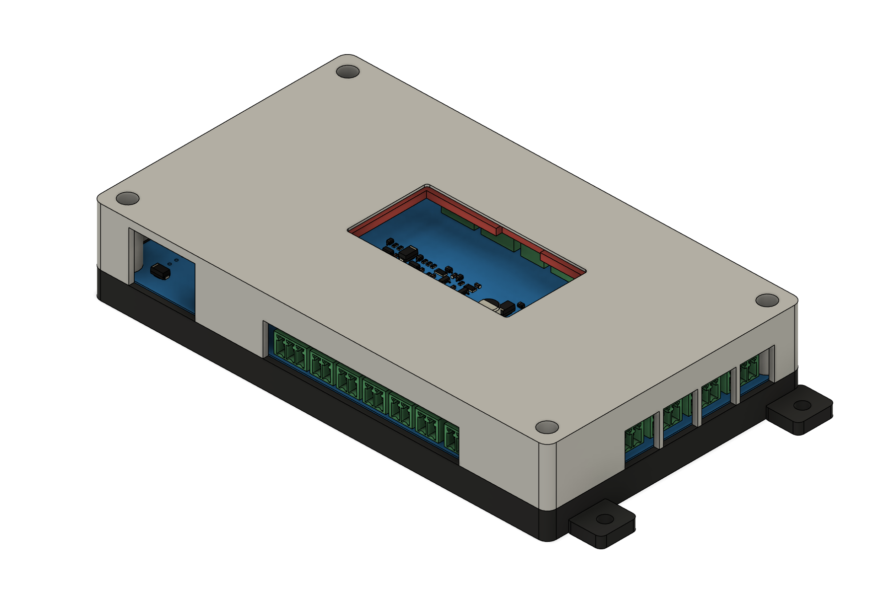
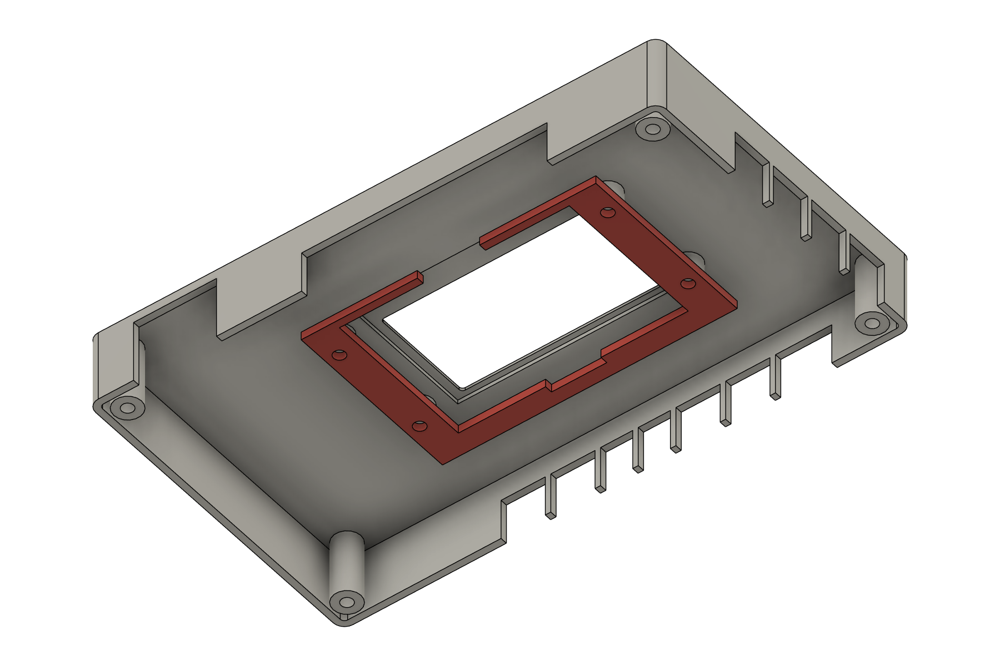

# Case for the Brineomatic Rev D-12V board

Status 13 Nov 2026: **first version built in Fusion; nothing printed, nothing test-fitted.** The figures below are the script's parameters and Fusion's results, not measurements of a printed part.

Fusion's interference check between the three case parts and the KiCad board model (`ref/`) finds no collision. That model has no dev board, no sockets, no mating plugs and no display, so the check says nothing about those.

| File | Content |
|---|---|
| `BrineCase/BrineCase.py` | Fusion script that builds the three parts and exports them |
| `ref/brineomatic_step23_board.step` | the board with its components, exported from KiCad (origin = board bottom-left corner), for fit checks |
| `DISPLAY_2.42_OLED.md` | the display's dimensions as read from the seller's drawing |
| `print/` | STL and STEP of each part, written by the script |
| `fusion/` | Fusion archive (`.f3d`), written by the script |
| `renders/` | screenshots from Fusion, written by the script |

## Parts

1. **Base.** Floor and a low wall that ends level with the top of the board. Four corner posts carry the board 6 mm above the floor
   (the longest pin under the board is 4.0 mm). Four screw-down lugs.
2. **Cover.** Walls and top. Every plug has its own notch, open towards the base, so the plugs and their cables leave between base and cover.
   One wider notch at the dev board's USB end serves both USB ports. A window and a shallow pocket in the top take the display's glass.
3. **Display clamp.** A flat U-shaped frame behind the display board (open at the bottom for the display's flex cable), screwed to four bosses in the cover. It holds the display without using
   the display's own mounting holes, because their spacing is not given in the seller's drawing.

Four M3 screws close the case: through the cover, through the board's corner holes, into heat-set inserts in the base posts. They also clamp the board.

## Key numbers (script parameters)

| | mm |
|---|---|
| Outside | 165.2 x 95.2 x 30.5; 189.2 wide over the lugs |
| Printed volume | base 42 cm3, cover 43 cm3, clamp 3.5 cm3 |
| Walls, floor, top | 2.0 |
| Gap board edge to wall | 0.6 |
| Board top above the outside bottom | 9.6 |
| Air above the dev board | 3.0 |
| Plug notch: width | header body + 0.4 each side; plugs closer than 1.2 mm of wall share one notch (RS485 and the five relays do) |
| Plug notch: height above the board | 12.0 (header is 7.55; the rest is room for the plug) |
| USB notch | 24.0 wide |
| Display window | 58.4 x 30.4, centred on the active area |
| Glass pocket | 63.2 x 39.8, 1.2 deep |

## Printing (0.4 mm nozzle)

- Base: floor on the bed. Cover: top face on the bed. Clamp: flat. No supports.
- 2.0 mm walls are five perimeters. All notches are open slots, so nothing bridges.
- The screw counterbores have a 45 degree cone seat instead of a flat ledge.

## Hardware

- 8 x M3 heat-set insert, 5 mm outside diameter, 4 mm long (4 base posts, 4 display bosses).
- 4 x M3 x 20 closing screw (socket head; the head sits 6.0 mm below the top face, 3.5 mm of thread reaches the insert).
- 4 x M3 x 6 for the display clamp.

## Not verified

- **Mating plugs.** Their height and how far they stick out are not measured. The notch height (12 mm) is a parameter. Plugs on the top and
  right edges sit 2.55 mm inside the board edge, so their fronts are about 5 mm behind the outside of the wall.
- **Display.** All dimensions are from the seller's drawing; hole spacing and glass offsets are scaled from it (see `DISPLAY_2.42_OLED.md`).
- **Dev board height.** Assumes the dev board's header plastic (2.5 mm) rests on the 8.5 mm sockets, as on the bilge alarm.
- **USB plugs.** One notch for both; plug grip sizes vary.
- **Display wiring.** There is about 6 mm between the display's pin header and the parts below; solder the four wires or use a right-angle header.
- No ventilation, no cable strain relief, no seal. The plug labels are on the board, inside the case; labels on the cover are not done yet.
