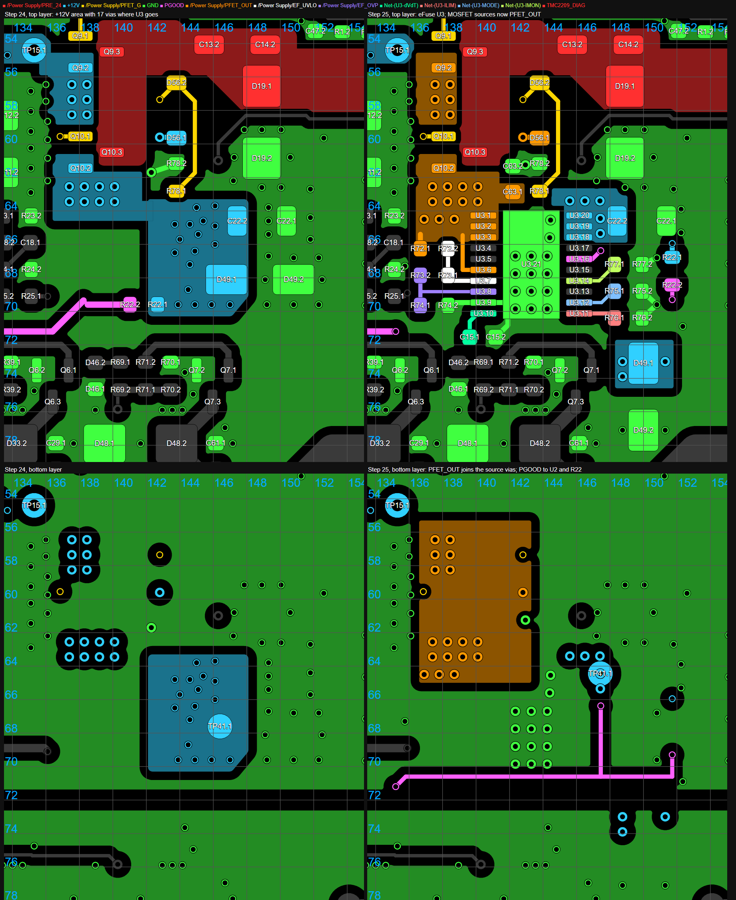

# Rev D step 25: a 12 V eFuse back on the board (independent review M2)

13 Nov 2026. Branch `rev-d-12v-efuse`, on top of step 24 (`1fb8413`, `REVIEW_FIXES.md`).
The independent review of step 22 (`INDEPENDENT_REVIEW_BRIEF.md`) listed four major findings after its two blockers. This step fixes M2 and records the owner's decisions on M3 and M4.

| Finding | Status after step 25 |
|---|---|
| M1 servo 5 V on 0.25 mm inner-layer tracks (161-230 mOhm) | open |
| M2 no current limit since the eFuse was removed: a short on +12V is carried by the two SOT-23 MOSFETs until the 3.15 A time-lag fuse opens | **fixed**: TI TPS16630 eFuse U3 between the MOSFETs and +12V |
| M3 no undervoltage lockout | **accepted by the owner** (13 Nov 2026): no undervoltage lockout wanted. U3's UVLO input is set to about 5.4 V, below anything a 12 V battery reaches in use |
| M4 4-20 mA sensors get about 8.3 V at a 10.5 V bus | **dropped by the owner** (13 Nov 2026): the sensor circuit is the same as on Rev-C1 (sensors on the main rail, same 100 Ohm shunts), and the battery is assumed to stay above 12 V (about 9.9 V at the sensor at 20 mA) |

**Update, step 26 (`SERVO_POWER.md`):** M1 fixed: the servo supply runs on 1.8-4.0 mm top-layer copper (13 mOhm).

Not uploaded to JLCPCB, **not quoted**. Untested.

*Top and bottom layer around the input. Red PRE_24 (fuse output), orange PFET_OUT (MOSFET sources, new), blue +12V, green GND, yellow MOSFET gate, magenta PGOOD.*

## What the eFuse does here

U3 is a TPS16630PWPR (TPS1663 family, HTSSOP-20 with exposed pad, 60 V, LCSC C1849461). It sits where Rev-C1 had its TPS26630: after the reverse-polarity stage (Q9/Q10, which stay) and before the +12V rail.

| Function | Part | Value | Result (TPS1663 datasheet, ti.com/lit/ds/symlink/tps1663.pdf) |
|---|---|---|---|
| Current limit | R76 ILIM | 4.7k | I_OL = 18 kOhm.A / R76 = **3.83 A** (+-10 %: 3.45-4.21 A). Above it U3 holds the current at the limit and switches off after 162 ms, or earlier if it overheats. A hard short trips the fast comparator (about 2 x I_OL) and U3 turns off within about 1 us (specified for a 45 A step), then limits again. Rev-C1: 4.53k, 3.97 A |
| After a fault | R75 MODE | 0R to GND | **auto-retry**, as Rev-C1. Leave R75 off (DNP) for latch-off: then U3 stays off until the supply is cycled |
| Overvoltage | R72 / R73 / R74 | 24k / 4.7k / 2.2k | off above **16.9 V** (16.2-17.5 V worst case with 1 % resistors and the 1.176-1.224 V threshold), on again below about 15.8 V: above a 15.5-16 V equalisation charge, below the 17.8 V minimum breakdown of the SMBJ16CA TVS diodes |
| Undervoltage | same divider | | on above 5.4 V, off below 5.0 V: no practical undervoltage lockout (M3, owner's decision) |
| Soft start | C15 dVdT | 100 nF | output ramps in about 25 ms at 12 V; with a few hundred uF on +12V the inrush is about 0.2 A |
| Current monitor | R77 IMON | 20k | 27.9 uA/A x 20 kOhm = **0.56 V per A** across R77 (measure at R77; the firmware does not read it) |
| Power good | PGOOD | existing net | open-drain to the buck enable (U2 pin 3, 24k pull-up R22 to +12V, as before): the 5 V buck starts once U3's output is up, as on Rev-C1 |
| Input capacitor | C63 | 1 uF | at the IN pins (datasheet: at least 0.1 uF) |
| Output | C22 10 uF, D49 SS34 | existing | D49 was Rev-C1's output Schottky (OUT to GND for inductive loads); kept, moved |

SHDN and FLT are not connected: SHDN has an internal pull-up (device on), FLT is an open-drain fault output. The earlier plan had a red fault LED on FLT and test points on SHDN and IMON; there was no room for them next to U3, so they were left out. The NC pins 4, 5 and 17 stay unconnected.

**What changes in a fault.** Before: a short on +12V was limited only by the battery, the wiring, the two AO3401A MOSFETs (rated 3.2 A each at 70 C) and the 3.15 A time-lag fuse F1, which takes from milliseconds to seconds to open at 10-50 A. Now: U3 cuts a short within about 1 us, then limits to 3.8 A and switches off after 162 ms; F1 is only the backup (for example if U3 fails short). An overload between the fuse rating and the limit (3.15-3.8 A) is still cleared by F1, slowly, as on a board without eFuse.

**Cost** (LIVE, JLCPCB 13 Nov 2026, from the step-24 discussion, not re-quoted): TPS16630PWPR C1849461 US$2.79, 2,760 in stock, Economic and Standard; one more Extended line (US$3.09 if charged); R75 0R C21189 is a Basic part; every other new part is on a BOM line the board already has. About US$17 more for 5 boards.

## Schematic (`tools/sch_add_efuse.py`)

- The MOSFET sources, D56's cathode and PWR_FLAG #FLG04 move from +12V to a new net **PFET_OUT**: the bus segment from D56 to TP15 is deleted and PFET_OUT is labelled at the end of the remaining segment.
- U3 with a local symbol (`brineomatic_local:TPS16630PWP`) and the parts above, in the free space at the bottom of the Power Supply sheet; connected by labels (PFET_OUT, EF_UVLO, EF_OVP, the global PGOOD, +12V). Reference designators follow Rev-C1 where Rev-C1 had the same function (U3, R72-R77, C15); C63 is new.
- The script writes deterministic UUIDs, so a second run on the step-24 sheet gives the same file.
- Netlist against step 24: 9 parts added (U3, C15, C63, R72-R77), 3 pins changed (Q9.2, Q10.2, D56.1: +12V -> PFET_OUT), nothing else.

## Layout (`tools/pcb_add_efuse.py`)

| # | Change |
|---|---|
| 1 | U3 sits below the MOSFETs at (143.3, 67.2) where step 24 had a +12V area. That area (top and bottom layer), its 17 vias and the In1 TMC2209_DIAG detour that wove through them are deleted; DIAG now runs straight under U3 on In1 (0.2 mm, 0.35 mm from TMC2209_RX). |
| 2 | Input: the two top-layer source areas of step 24 become PFET_OUT and no longer touch +12V (Q9's area no longer joins the TP15 pour). Their 14 vias and D56's via now go to a new PFET_OUT area on the bottom layer, which joins Q9's source to Q10's. Q10's area runs on to U3's IN pins 1-3 and C63; three more vias at its lower edge. |
| 3 | Left of U3: R72-R74 (UVLO/OVP divider) in a column, P_IN (pin 6) to the PFET_OUT area, GND pin 9 to the exposed pad; C15 below U3. D20-A's via moved 0.2 mm so that R74 fits; R24's ground pad, cut off from the ground pour by the column, got its own via. |
| 4 | Output: OUT pins 18-20 and C22 (moved 1 mm right) share a new +12V area with five vias to the inner +12V plane (In2). TP41 (bottom test pad) moved onto one of those vias. |
| 5 | Right of U3: R77 (IMON), R75 (MODE), R76 (ILIM) in a column, ground side to two vias. Exposed pad: 14 vias to the ground planes, all clear of the two In1 tracks that cross under U3. |
| 6 | PGOOD: U3 pin 16 -> via -> bottom layer -> via at (135.2, 71.2) -> the existing track to U2 pin 3. R22 (24k pull-up) moved to the right of the resistor column and joins the same bottom-layer track; the old top-layer PGOOD track past U3 is deleted. |
| 7 | D49 (SS34) moved to the free space between Q7 and F1, cathode up on its own +12V area with three vias. The "FUSE 5x20" label moved between D49 and F1 (one line, 0.8 mm). |
| 8 | Silkscreen: references of Q10, C22, D49, R22 moved; references of the new parts in the columns (C15, R72-R77) and of C18, R24, D46 (now covered) hidden, as the board already does for 72 parts (for example R69-R71 next to U3). |

**Numbers.** Copper 35 um outer, 17.5 um inner, 20 C, `tools/cusheet.py`, 0.05 mm grid.

| Path | Value |
|---|---|
| F1 pin 2 -> Q9 / Q10 drain | 2.3 / 3.1 mOhm (as step 24) |
| Q10 source -> U3 IN pins | 0.50 mOhm |
| Q9 source -> its 6 vias | 0.13 mOhm; with the vias and the bottom-layer area about 1 mOhm more than Q10's path, so the 41-50 mOhm MOSFETs still share within about 2 % |
| U3 OUT pins -> their 5 vias | 0.06 mOhm, plus about 0.25 mOhm for the vias to In2 |
| U3 on-resistance (datasheet) | 30 mOhm typical, 33-45 mOhm at 85 C: 0.09-0.14 V and 0.27-0.4 W at 3 A |
| F1 -> +12V drop at 3.15 A | at most about 0.23 V (MOSFETs <= 25 mOhm, U3 <= 45 mOhm, copper about 4 mOhm) |

## BOM and placement file (`tools/make_jlc.py`)

- New BOM lines: TPS16630PWPR C1849461 (U3, Extended) and 0R C21189 (R75, Basic). C15, C63, R72-R74, R76, R77 join existing lines (100nF, 1uF, 24k, 4.7K, 2.2k, 4.7K, 20k).
- `make_jlc.py` gets the Fabrication-Toolkit package rule for `^HTSSOP-` (270 deg; the toolkit's `transformations.csv` has no other rule that matches U3's footprint): U3 is written at 270.
- CPL: 9 rows added; C22, D49 (-90, D_SMA has no correction) and R22 (-90) moved.

## Verification

- KiCad 10.0.6 DRC with schematic parity, all severities (`baseline/rev_d_step25_drc.json`): **0 unconnected**; 252 violations against 253 at step 24 (Q10's reference no longer overlaps its own outline; nothing new). The rest are silkscreen warnings, the standoff warnings (4 hole clearance, 4 mask bridge), the old dangling via, and library notes: this kicad-cli has no footprint-library table, so it notes every footprint, the new ones included, and its report stops at 199 of them.
- Parity: no net or footprint mismatch. KiCad's report stops at 199 entries per type, so the "199 stale footprint fields" quoted since step 15 is that limit, not a count. Own count (`tools/check_parity.py`: every netlist field against the footprint, pad nets against the netlist), identical for step 24 and step 25: 118 differing fields in 82 footprints (LCSC 82, Description 27, other 9) plus the Datasheet `~` / empty difference on most passives that KiCad also reports; 0 pad-net differences, no missing or extra footprint; none on the new parts.
- ERC (`baseline/rev_d_step25_erc.json`): 0 errors; 462 entries, all library-link notes (step 24: 436; the 26 new ones are the 9 new symbols and their power symbols).
- Pours: PFET_OUT is one island on each layer (top Q9 area, top Q10 area, bottom area with 18 vias); PRE_24 is still one island from F1 pin 2 to both drains; the new +12V areas are one island each; the In2 +12V plane is still one island. A ground cluster check (own union-find over pours, vias, pads and tracks) finds the same ground fragments as step 24 and no new one.
- `tools/trace_connectors.py`: every plug pin reaches every pad of its net (0 unreached).
- Gerbers (`mfg/gerbers-rev_d_step25.zip`, `tools/make_gerbers.py`): 887 drill hits = 744 vias + 143 pad holes (step 24: 880 = 737 + 143).
- Renders: `rev_d_pcb_step25_top.png`, `rev_d_pcb_step25_bottom.png`.
- Step 26 replaced these baselines, renders and the gerber zip with its own (`SERVO_POWER.md`); the step-25 files are in commit 964d7b9.

## Still to do by a person, before paying

- In JLCPCB's placement preview: **U3** (pin 1 dot; the 270 deg rule comes from the toolkit's table, there is no Rev-C1 precedent for this package or LCSC part) and **D49**, which is now vertical, in addition to the list in `REVIEW_FIXES.md`.
- Bench tests in `BRINGUP_TEST_PLAN.md` (current limit, short, overvoltage cut-off, PGOOD start-up order, U3 temperature).
- Human review of the layout; this step was laid out by script.

## Reproduce

    git show 1fb8413:brineomatic/brineomatic.kicad_pcb > step24.kicad_pcb
    git show 1fb8413:brineomatic/power_supply.kicad_sch > brineomatic/power_supply.kicad_sch
    python rev-d-12v/tools/sch_add_efuse.py brineomatic
    kicad-cli sch export netlist --format kicadxml -o rev_d.xml brineomatic/brineomatic.kicad_sch
    python rev-d-12v/tools/pcb_add_efuse.py step24.kicad_pcb rev_d.xml brineomatic/brineomatic.kicad_pcb
    KICAD_CLI=<kicad-cli> python rev-d-12v/tools/make_jlc.py rev_d.xml brineomatic/brineomatic.kicad_pcb rev-d-12v/mfg
    KICAD_CLI=<kicad-cli> python rev-d-12v/tools/make_gerbers.py brineomatic/brineomatic.kicad_pcb rev-d-12v/mfg/gerbers-rev_d_step25.zip
    python rev-d-12v/tools/cusheet.py brineomatic/brineomatic.kicad_pcb F.Cu 35 "/Power Supply/PFET_OUT" 0.05 135.5,59.5,143.5,66.5 Q10.2 U3.1,U3.2,U3.3

The scripts run in KiCad 10's Python. `pcb_add_efuse.py` loads the new footprints from KiCad's library (`KICAD10_FOOTPRINT_DIR`, default: the author's KiCad folder) and saves with `SaveBoard(..., True)` so that the project file is left alone.
