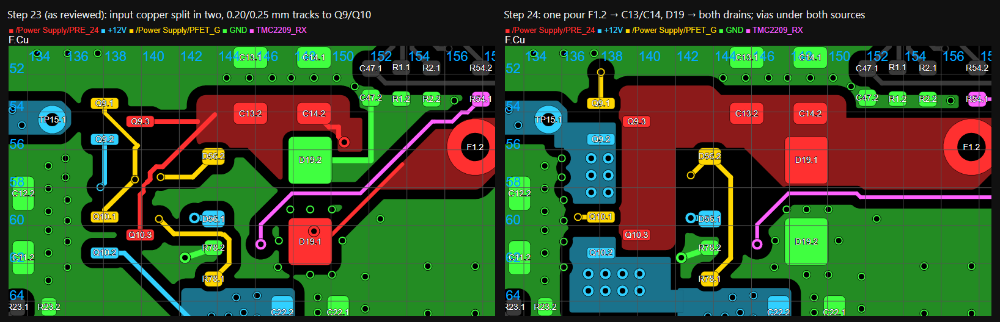

# Rev D step 24: the two blockers of the independent review fixed

13 Nov 2026. Branch `rev-d-12v-review-fixes`, on top of `rev-d-12v-labels` step 23 (`26c1853`).
The independent review of step 22 (`32b05db`, brief: `INDEPENDENT_REVIEW_BRIEF.md`) found two blockers. Step 23 did not touch either.

| Blocker | Finding | Status after step 24 |
|---|---|---|
| B1 | Fuse to MOSFETs to +12V through 0.20/0.25 mm tracks and single vias: 34 / 45 mOhm, the 0.20 mm track melts before the 3.15 A fuse | **Fixed**: one pour, 2.3 / 3.1 mOhm |
| B2 | CPL without JLCPCB rotation corrections: about 20 SMD parts turned (all SOT-23, U1, U4, U9, U10) | **Fixed in the generator; still to be checked in JLCPCB's placement preview** |

**No net was changed and no part was added or removed.** The BOM is unchanged. Not uploaded to JLCPCB, **not quoted**. Untested.

*Top layer around the input. Red PRE_24 (fuse output), blue +12V, yellow MOSFET gate, green GND, magenta TMC2209_RX.*

## B1: input power path (`tools/pcb_review_fix_power.py`)

**What was wrong.** The PRE_24 pour around F1 pin 2 was cut off from the pour around C13/C14 twice:

1. by the ground jumper from C47 pin 2 to D19: D19's pins had been swapped in the schematic during the SMBJ16A/SMBJ16CA change, so its ground pad sat inside the input copper;
2. by the TMC2209_RX track, which ran diagonally through the input copper from R54 to the via at (146.3, 61.0). The review report named only the jumper; removing the jumper alone still leaves two islands (checked).

The fuse half reached the rest only through a 0.20 mm track, a via, a 0.25 mm bottom track and a second via, and the drains through 0.25 mm tracks. The sources reached +12V through 0.25 mm tracks.

**What changed.**

| # | Change |
|---|---|
| 1 | D19 (SMBJ16CA, two-way TVS) turned 180 deg in place: its PRE_24 pad is now the upper pad in the input copper and its GND pad sits in the ground pour with the eight ground vias around it, as on Rev-C1. The ground jumper C47.2 -> D19 is deleted; C47 pin 2 stays in the main ground pour, which also holds its ground via. The C13/C14 labels moved clear of D19's outline. |
| 2 | TMC2209_RX re-routed on the top layer from R54 around the right side of F1 and along the lower edge of the input copper to the existing track (0.2 mm, no via). |
| 3 | All 28 thin PRE_24 tracks and both PRE_24 vias deleted. The PRE_24 pour now runs from F1 pin 2 over C13, C14 and D19 to both drains: at least 2.5 mm wide (beside D56), 2.85 mm on the branch to Q10. The 1.0 mm bottom track from F1 pin 2 to test point TP39 stays. |
| 4 | Each source has its own +12V area on the top layer with vias to the inner +12V plane (In2): Q9 6, Q10 8 (0.3 mm hole, 0.6 mm pad). Q9's area also joins the +12V pour at TP15/C10-C12 (1.4 mm shared edge), Q10's area the +12V pour at C22/D49 (1.8 mm); the vias are the main path. The 0.25 mm source tracks and their via are deleted. |
| 5 | The gate net PFET_G no longer crosses the power path: Q9 and Q10 gates go to vias on their outer side and are joined on In1; In1 continues to a via beside D56; D56 (anode) and R78 are joined on top. D56 and R78 did not move. The via above Q9 is placed so that it does not close the 1.1 mm neck that joins the TP15 corner of the In2 +12V plane to the rest of the plane. |

**Numbers.** Copper 35 um outer, 17.5 um inner, 20 C.

| Path | Step 23 | Step 24 | How |
|---|---|---|---|
| F1 pin 2 -> Q9 drain | 34 mOhm | **2.3 mOhm** | `tools/cusheet.py`, 0.05 mm grid (0.1 mm grid within 1 %) |
| F1 pin 2 -> Q10 drain | 45 mOhm | **3.1 mOhm** | same |
| Q9 / Q10 source -> In2 +12V plane | 6.1 / 13.5 mOhm to the loads | **0.35 / 0.30 mOhm** | pour 0.13 mOhm (`cusheet.py`) + vias 1.2-1.3 mOhm each (18-20 um plating, 1.32 mm from top to In2) / 6 or 8 |
| Narrowest copper, fuse to drains | 0.20 x 0.035 mm | 2.5 x 0.035 mm | |
| Melting integral of that copper (adiabatic, 226 A s^0.5/mm2) | 2.5 A2s | about 390 A2s | the 5x20 T3.15A fuse melts at tens of A2s, so the fuse opens first again |
| Temperature rise of that copper (IPC-2221, outer layer) | about 95 C at 2 A | about 4 C at 3.15 A, 8 C at 4.25 A | |
| Current share Q9 / Q10 | about 56 / 44 % | about 50.5 / 49.5 % | 0.8 mOhm difference on 41-50 mOhm Rds(on) |

`cusheet.py` solves the current flow in the actual filled copper; it was checked against R = rho L / (w t) on a straight track (within 3 %).
The review's `cunet.py` treats pours as ideal and is therefore not usable for the new pour.

## B2: placement file (`tools/make_jlc.py`, `tools/sch_clear_rotation_offsets.py`)

**What was wrong.** `make_jlc.py` wrote KiCad's raw rotation. Rev-C1 was produced with the Fabrication-Toolkit plugin, which adds a JLCPCB correction per package and the part's `Rotation Offset` field:
Rev-C1's committed `fabrication-toolkit-options.json` has AUTO TRANSLATE on; the author's commits `8b82ab2` "updated jlc parts rotations and placement offsets", `ec6f392` "bom and cpl file are good" and `f489a79` "sent to production";
and the toolkit's position file for the Rev-C1 board (`brineomatic/production/brineomatic_positions.csv`, git-ignored, made on 21 Oct 2026 with toolkit v5.3.1) follows **CPL rotation = KiCad rotation + package correction + field** in all 243 rows.

**What changed.**

- `make_jlc.py` applies the same rule. Only the four package rules that match a footprint on this board are written into the script (`^CP_Elec_` 180, `^SOIC-` 270, `^SOT-23` 180, `^TSSOP-` 270, from the toolkit's `transformations.csv`). It prints every correction, and it warns about any package that has neither a rule nor a checked "no correction" entry. kicad-cli comes from the `KICAD_CLI` environment variable (default: the macOS path as before); a failed position export now stops the script.
- Ten `Rotation Offset` fields were stale: Rev-C1 values for parts the remix replaced. They are deleted from the schematic: D18 180 (now 1N4148W C81598, the part Rev-C1 placed as D20 with no correction), J4/J11, J5/J22, J21 180 and J1/J28, J6/J29 270 (now 3.5 mm terminals, placement checked in JLCPCB's viewer with no correction). The fields that are still right stay: C21/C23/C57 180, U2 90, U4 90, U9 270. Netlist: same 122 nets, same parts, only these fields differ.

**CPL changes** (`mfg/CPL-rev_d.csv`; all 210 positions unchanged):

| Part | Package | KiCad | + package | + field | CPL now (was) |
|---|---|---|---|---|---|
| Q1, Q4, Q5, Q6, Q7 | SOT-23 | -90 | 180 | | 90 (-90) |
| Q2, Q9, Q10, D9, D42, D44 | SOT-23 | 0 | 180 | | 180 (0) |
| D4, D35 | SOT-23 | 180 | 180 | | 0 (180) |
| D6, D24 | SOT-23 | 90 | 180 | | 270 (90) |
| U1 ADS1115 | TSSOP-10 | 0 | 270 | | 270 (0) |
| U4 MAX40200 | SOT-23-5 | 180 | 180 | 90 | 90 (180) |
| U9 TMC2209 | VQFN-28 | 0 | | 270 | 270 (0) |
| U10 SP3485EN | SOIC-8 | -90 | 270 | | 180 (-90) |
| C21, C23, C57 | CP_Elec | | 180 | 180 | unchanged |
| U2 RT7272B | SOIC-8 EP | | 270 | 90 | unchanged |
| D19 | D_SMB | -90 | | | -90 (90): turned in B1; two-way TVS |

`mfg/CPL-rev_d_with_plugs.csv` gets the same corrections; its eight plug rows (PJ3, PJ4, PJ5, PJ10, PJ11, PJ18, PJ21, PJ22) still had pre-step-20 or pre-step-23 positions and now match their terminals.

**Still to do by a person, before paying.** A rule table cannot prove JLCPCB's library orientation for each LCSC part. In JLCPCB's placement preview, check every MOSFET, diode, LED, IC and electrolytic capacitor against its pin-1 or cathode mark. Look hardest at the parts without a Rev-C1 precedent: D56 BZT52C10 (a reversed gate zener leaves both MOSFETs almost off), C21/C23 C3342 and C57 C3349 (new LCSC numbers). Tick the option to confirm the parts placement before production.

## Verification

- KiCad 10.0.6 DRC with schematic parity, all severities (`baseline/rev_d_step24_drc.json`): **0 unconnected**; 253 violations against 254 at step 23 (one silkscreen-over-pad warning fewer, nothing new; all silkscreen and library notes). Parity: the stale footprint-field texts known since step 15, no net or footprint mismatch (199 is the limit of KiCad's report per type, not a count: see `EFUSE.md`). (The step-23 baseline, which this file replaces, was run on a copy without the schematic beside it, so it showed no parity entries; step 17 shows the same 199.)
- ERC (`baseline/rev_d_step24_erc.json`): 436 entries, same count and types as step 17 (library-link notes only).
- Pours: PRE_24 is one island holding F1.2, C13.2, C14.2, D19.1, Q9.3 and Q10.3 (step 23: two). The In2 +12V plane is still one island; no new ground fragments.
- `tools/trace_connectors.py`: every plug pin reaches every pad of its net (0 unreached), as at step 23.
- Gerbers (`mfg/gerbers-rev_d_step24.zip`, `tools/make_gerbers.py`): the script reproduces `gerbers-rev_d_step23.zip` from the step-23 board byte for byte apart from the date lines. 880 drill hits = 737 vias + 143 pad holes.
- Renders: `rev_d_pcb_step24_top.png`, `rev_d_pcb_step24_bottom.png`.
- Step 25 replaced these baselines, renders and the gerber zip with its own (`EFUSE.md`); the step-24 files are in commit 1fb8413.

## Not fixed here (the review's other findings stand)

**Update, step 25 (`EFUSE.md`):** M2 fixed (TPS16630 eFuse U3 back after the MOSFETs); M3 accepted and M4 dropped by the owner on 13 Nov 2026; M1 and the minor findings still open.

M1 servo 5 V on 0.25 mm inner-layer tracks (161-230 mOhm); M2 no current limit since the eFuse was removed (the MOSFETs carry a short until the fuse opens); M3 no undervoltage lockout; M4 4-20 mA sensors get about 8.3 V at a 10.5 V bus; the minor findings; note N1 (the standoffs H1-H4 are not in the BOM, Rev-C1's position file places them).
The footprint fields on the board (LCSC numbers and others) still differ from the schematic in 199 places. `make_jlc.py` reads the schematic, so its BOM is right, but a board-based tool such as the Fabrication-Toolkit would pick wrong parts until the board is updated from the schematic.

## Reproduce

    git show 26c1853:brineomatic/brineomatic.kicad_pcb > step23.kicad_pcb
    python rev-d-12v/tools/pcb_review_fix_power.py step23.kicad_pcb brineomatic/brineomatic.kicad_pcb
    python rev-d-12v/tools/sch_clear_rotation_offsets.py brineomatic          # once, on the step-23 schematic
    kicad-cli sch export netlist --format kicadxml -o rev_d.xml brineomatic/brineomatic.kicad_sch
    KICAD_CLI=<kicad-cli> python rev-d-12v/tools/make_jlc.py rev_d.xml brineomatic/brineomatic.kicad_pcb rev-d-12v/mfg
    KICAD_CLI=<kicad-cli> python rev-d-12v/tools/make_gerbers.py brineomatic/brineomatic.kicad_pcb rev-d-12v/mfg/gerbers-rev_d_step24.zip
    python rev-d-12v/tools/cusheet.py brineomatic/brineomatic.kicad_pcb F.Cu 35 "/Power Supply/PRE_24" 0.05 138.5,52,160,62 F1.2 Q9.3 Q10.3

The scripts run in KiCad 10's Python. pcbnew's `SaveBoard()` rewrites the project file with default settings unless its third argument is `True`; `pcb_review_fix_power.py` passes `True`.
