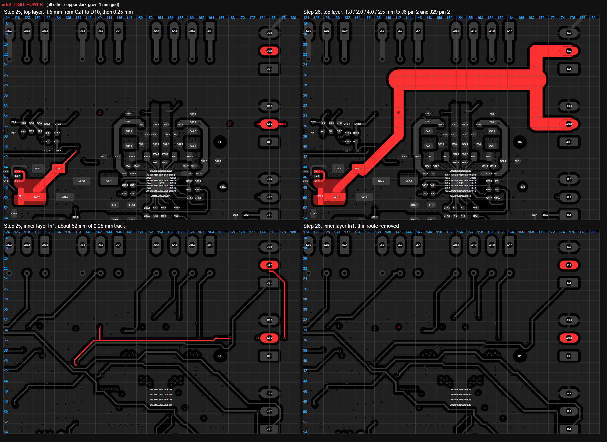

# Rev D step 26: wide top-layer copper for the servo supply (independent review M1)

14 Nov 2026. Branch `rev-d-12v-servo-power`, on top of step 25 (`964d7b9`, `EFUSE.md`).
The independent review of step 22 (`INDEPENDENT_REVIEW_BRIEF.md`) found the servo 5 V supply, net 5V_HIGH_POWER, on 0.25 mm tracks that ran mostly on an inner layer (M1). This step re-routes it on the top layer with wide copper. With it, the review's four major findings are all closed.

| Finding | Status after step 26 |
|---|---|
| M1 servo 5 V on 0.25 mm inner-layer tracks (161-230 mOhm) | **fixed**: 1.8-4.0 mm top-layer route, 13 mOhm |
| M2 no current limit since the eFuse was removed | fixed in step 25 (`EFUSE.md`) |
| M3 no undervoltage lockout | accepted by the owner (13 Nov 2026) |
| M4 4-20 mA sensors get about 8.3 V at a 10.5 V bus | dropped by the owner (13 Nov 2026) |

No net change; no part added, removed or moved; BOM and CPL unchanged. Not uploaded to JLCPCB, **not quoted**. Untested.

*5V_HIGH_POWER in red, all other copper dark grey. Upper row: top layer. Lower row: inner layer In1, where step 25 ran about 52 mm of 0.25 mm track.*

## What was wrong

The servo supply comes from the 5 V buck through the PTC fuse F2 and C21/D10 to pin 2 of the two servo terminals, J6 (SERVO 1) and J29 (SERVO 2), at the east edge. At step 25 only the first 10 mm, F2 -> C21 -> D10, were wide (a top-layer area and a 1.5 mm track). From D10 the supply went on as 0.25 mm track: 4.7 mm on top, a via, about 33 mm on In1, 5.3 mm on the bottom layer, up to J29 pin 2, then 3 mm on top to another via and 16 mm on In1 to J6 pin 2.

That was 230 mOhm from F2 to J6 pin 2 and 161 mOhm to J29 pin 2 (review appendix C; inner copper 17.5 um). A servo drawing 2 A lost about 0.4 V on the way and heated a buried track by about 0.9 W. A stalled servo or a shorted servo cable could burn that track open: F2 does not protect a 0.25 mm inner track, and the real limit is the buck's, about 3.4 A peak. Rev-C1 used a 1.5 mm top track, 5-6 mOhm on its smaller board.

## Layout (`tools/pcb_servo_power.py`)

| # | Change |
|---|---|
| 1 | Deleted: every thin 5V_HIGH_POWER track east of D10, 25 segments (8 top, 15 In1, 2 bottom), and 4 of its vias. Kept: the F2/C21/U4 area, the 1.5 mm track from C21 to D10 (as Rev-C1), and test point TP42 (bottom pad) with its via and bottom-layer link. |
| 2 | New route, all on the top layer: from D10 pin 1 a 1.8 mm diagonal between the Net-(D11-A2) via and the +5V via, 2.0 mm north at x 142.7, **4.0 mm east at y 26.6**, a 2.5 mm trunk at x 169.6, and 2.5 mm into J6 pin 2 and J29 pin 2. The 4.0 mm run uses the empty band between the top plug row (its link vias end at y 23.2) and the TMC2209 area (its first vias at y 30.3). |
| 3 | The TP42 via moved 0.14 mm west onto the centre line of the 2.0 mm track, which now ends on it from both sides; its bottom-layer link follows. One ground stitching via, in the way of the 2.0 mm track, moved 1.2 mm west: (141.6, 31.55) -> (140.4, 31.55). |
| 4 | Nothing else was moved or re-routed. The top-layer ground pour gives way around the new route (260 mm2 less ground on the top layer). The ground pours on In1 and the bottom layer fill the space of the deleted thin route (51 mm2 more). On saving, KiCad also writes its default text thickness into the hidden LCSC field of the nine step-25 parts; this changes only the file's formatting. |

The narrowest gaps to other copper: 0.26-0.27 mm to the two vias beside the diagonal near D10, 0.28 mm to a ground via at (144.2, 32.43), and 0.41 mm to a ground via at (167.9, 36.1). The board's minimum clearance is 0.2 mm. The 1.8 mm width of the diagonal is set by the gap between those two vias.

**Numbers.** `tools/cunet.py` (copied from the review's scripts), 35 um outer copper, 17.5 um inner, pours counted as ideal.

| Path | Step 25 | Step 26 |
|---|---|---|
| F2 pin 1 -> J6 pin 2 | 230.5 mOhm | **13.1 mOhm** |
| F2 pin 1 -> J29 pin 2 | 161.2 mOhm | **13.7 mOhm** |
| Narrowest element | 0.25 mm on In1 | the 1.5 mm C21 -> D10 track (unchanged, as Rev-C1) |
| Drop at 2 A | 0.32-0.46 V | 26-27 mV |
| Drop at the buck limit, 3.4 A | - | 45-47 mV |

Rev-C1 had 5-6 mOhm because its 2x3 servo header J6 sat only 10-12 mm of 1.5 mm track from D10. Here the servo terminals are at the east edge (register D2), and the route from D10 to J6 is about 60 mm long. Per millimetre, the new copper is 1.2-2.7 times as wide as Rev-C1's 1.5 mm track. Heat: at 3.4 A the 1.8 mm diagonal, the narrowest new piece, warms by about 8 C (IPC-2221, outer layer, 35 um), and the whole route dissipates about 0.15 W.

**Signals near the new route.** The route crosses over In1 tracks that run from the plugs to the middle of the board. Length within 0.4 mm in plan view (the measure `TDS_SIGNAL_ANALYSIS.md` used on one layer, here across layers):

| Signal | Step 25 | Step 26 |
|---|---|---|
| BRINE_TDS | 2.1 mm | 6.4 mm, crossings on In1 under the route |
| PRODUCT_TDS | 1.4 mm | 3.6 mm, crossings on In1 under the route |
| SERVO 1 signal (after R11) | 23 mm beside the thin route on In1 | 16 mm on In1 under the route |
| SERVO 2 signal (after R12) | 25 mm on the bottom layer under the thin route | 3 mm |

The servo supply is DC with small steps. The TDS crossings make at most about 0.6 pF (0.1 mm dielectric, as in the board's stack-up), so a 0.1 V step on the supply puts about 0.6 uV on the 100 nF TDS filter capacitor: a hundredth of one ADS1115 step (62.5 uV). This is an order-of-magnitude estimate, not a measurement; the bench check of `TDS_SIGNAL_ANALYSIS.md` (log the TDS inputs while the servos move) covers it.

## Verification

- KiCad 10.0.6 DRC with schematic parity, all severities (`baseline/rev_d_step26_drc.json`): **0 unconnected**; 252 violations, identical to step 25 in every type and every entry. Only the library notes, at the 199-entry report limit, cannot be compared entry by entry. The parity entries are identical too.
- Parity, own count (`tools/check_parity.py`): 118 differing fields in 82 footprints, 0 pad-net differences, as at step 25.
- ERC (`baseline/rev_d_step26_erc.json`): schematic unchanged; 462 entries, the same as step 25.
- `tools/trace_connectors.py`: every plug pin reaches every pad of its net (0 unreached). J6 pin 2 and J29 pin 2 reach all 7 other 5V_HIGH_POWER pads, TP42 included.
- Pours: 5V_HIGH_POWER is one copper cluster. Ground: the same 8 small fragments as step 25 and no new one (own union-find over pours, vias, pads and tracks). Each ground pour has the same number of islands as at step 25 on the top and bottom layer, and one fewer on In1. Every other pour is unchanged, except that the In2 +3.3V plane gains 5 mm2 where the four deleted vias were.
- Gerbers (`mfg/gerbers-rev_d_step26.zip`, `tools/make_gerbers.py`): 883 drill hits = 740 vias + 143 pad holes (step 25: 887 = 744 + 143).
- Renders: `rev_d_pcb_step26_top.png`, `rev_d_pcb_step26_bottom.png`. Step 26 replaced the step-25 baselines, renders and gerber zip; the step-25 files are in commit 964d7b9.

## Still to do by a person, before paying

- Bench test 18 in `BRINGUP_TEST_PLAN.md` (servo supply under load).
- Human review of the layout; this step was laid out by script.
- The JLCPCB placement-preview checks listed in `REVIEW_FIXES.md` and `EFUSE.md`. Step 26 moves no part, so it adds none.

## Reproduce

    git show 964d7b9:brineomatic/brineomatic.kicad_pcb > step25.kicad_pcb
    python rev-d-12v/tools/pcb_servo_power.py step25.kicad_pcb brineomatic/brineomatic.kicad_pcb
    KICAD_CLI=<kicad-cli> python rev-d-12v/tools/make_gerbers.py brineomatic/brineomatic.kicad_pcb rev-d-12v/mfg/gerbers-rev_d_step26.zip
    python rev-d-12v/tools/cunet.py brineomatic/brineomatic.kicad_pcb 35 17.5 5V_HIGH_POWER F2.1 J6.2 J29.2

The scripts run in KiCad 10's Python. `pcb_servo_power.py` saves with `SaveBoard(..., True)` so that the project file is left alone. The schematic, BOM and CPL are unchanged, so `make_jlc.py` is not needed.
